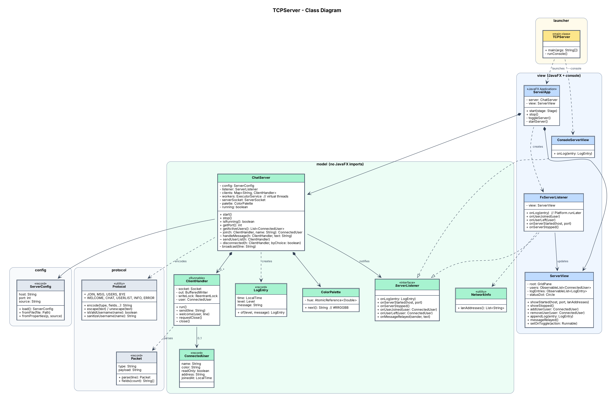
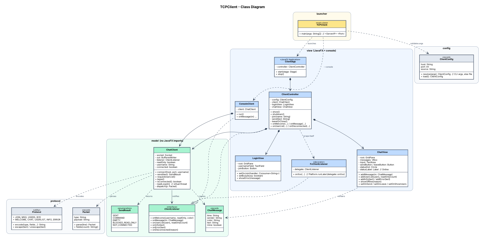
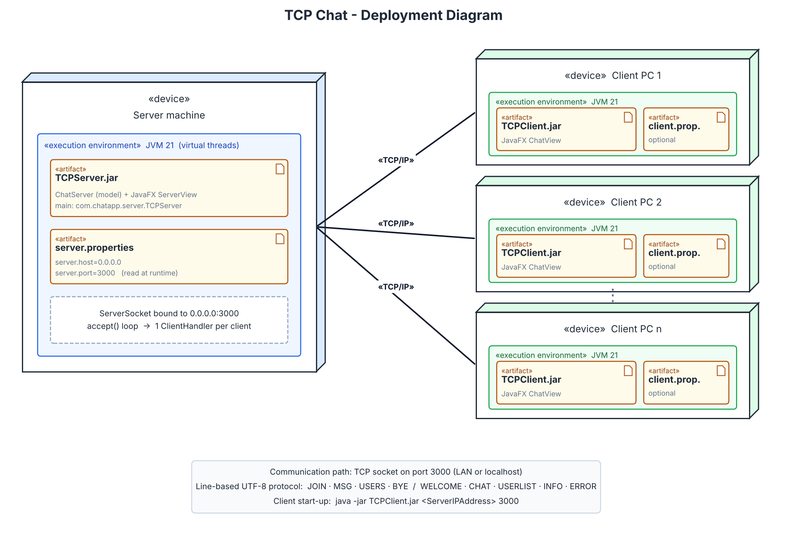
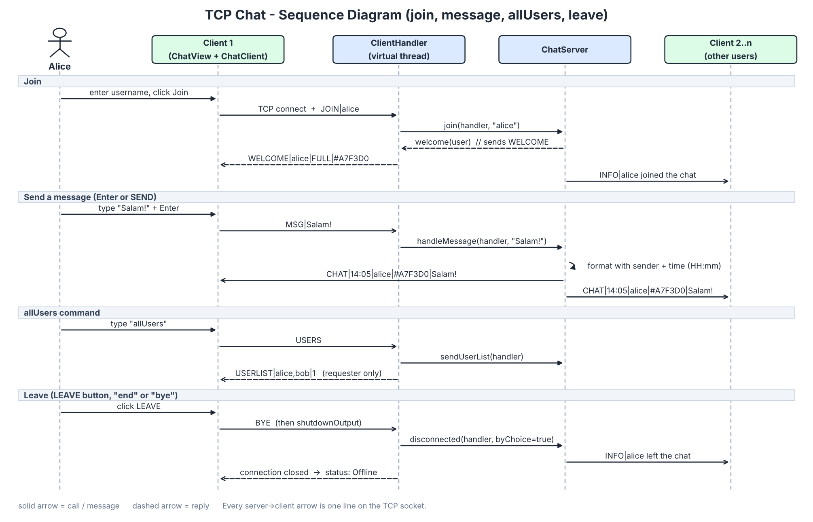
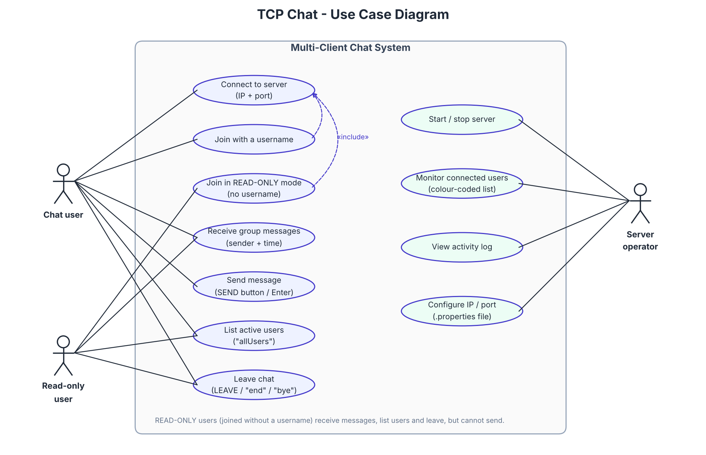

# TCP Group Chat — Java Sockets · Virtual Threads · JavaFX

A multi-client group chat built on raw **TCP sockets**. A central **server** relays every message to all
connected **clients**. Each client runs on its own **virtual thread** (JDK 21), and both sides have a
**JavaFX** interface laid out with `GridPane` and styled with CSS.

> Mini Project 1: *Multi-Client Chat Application Using Java Sockets* (instructor: El Habib Nfaoui)
> Author: Ali BERAOUZ

---
## Links
1. Video demo (Uploaded to Youtube): https://youtu.be/h8PTQhYCpW0
## Contents

1. [Features and requirement mapping](#1-features-and-requirement-mapping)
2. [Quick start](#2-quick-start)
3. [Running from IntelliJ IDEA](#3-running-from-intellij-idea)
4. [Configuration (IP and port)](#4-configuration-ip-and-port)
5. [Architecture](#5-architecture)
6. [Communication protocol](#6-communication-protocol)
7. [UML diagrams](#7-uml-diagrams)
8. [Tests](#8-tests)
9. [Troubleshooting](#9-troubleshooting)

---

## 1. Features and requirement mapping

| Requirement (spec section) | Implementation |
|---|---|
| **2.1** Username before the full chat interface | `LoginView`: the chat screen only opens after the server answers `WELCOME` |
| **2.1** READ-ONLY mode without a username | Empty username → server assigns `Guest-N` in read-only mode. The client disables the input and shows a yellow **READ-ONLY MODE** banner. The **server also enforces it**: any `MSG` from a read-only user is rejected with an `ERROR`. |
| **2.1** Send with **SEND** button or **Enter** | `ChatView`: Enter sends, Shift+Enter inserts a new line |
| **2.1** `allUsers` command | Typing `allUsers` (or clicking *Who's online*) sends `USERS`. The server replies to **that user only** with `USERLIST`. |
| **2.1** Disconnect with `end`, `bye` or **LEAVE** | Client sends `BYE` and closes. The server logs "*X left the chat*" and notifies the others. |
| **2.1** "Online" label + visual indicator | Header shows a green `Circle` + **Online**. On disconnect it turns grey + **Offline**. |
| **2.2** Multiple concurrent clients | `ChatServer` accept loop + one `ClientHandler` per client on a **virtual thread** (`Executors.newThreadPerTaskExecutor(Thread.ofVirtual()…)`) |
| **2.2** Format with username + time, send to all | Server builds `CHAT\|HH:mm\|sender\|color\|text` and sends it to **every active connection** |
| **2.2** Live `ListView` of connected users | `ServerView`: user list updated on each join and leave |
| **2.2** Random background colour per user | `ColorPalette` gives every user a random pastel colour, used in the server list and in the clients' message bubbles |
| **2.2** Activity log | "Server Started", "Waiting for Client...", "Client connected from …", "Welcome X", messages, leaves; colour-coded by level |
| **3.1** Java · TCP sockets · JavaFX `GridPane` + CSS · IntelliJ | `ServerSocket`/`Socket`; every screen's root is a `GridPane`; styles in `css/server.css`, `css/client.css` |
| **3.2** Multithreading with virtual threads | See [5.3 Threading model](#53-threading-model) |
| **3.3** IP/port from a config file at runtime | `server.properties` / `client.properties`, read when the app starts. No recompilation needed. |
| **3.3** Model–View separation | `model` packages have **zero JavaFX imports**. Proven two ways: a console view (`--console`) reuses the same model, and the tests run the model with no UI at all. |
| **4.1** `TCPClient <ServerIPAddress> <PortNumber>`, `TCPServer` | `java -jar TCPClient.jar localhost 3000`, `java -jar TCPServer.jar` |
| **5** Maven projects, JARs, UML, README | `TCPServer/`, `TCPClient/`, `build.sh` / `build.bat` → `dist/*.jar`, `chat-app/docs/uml/` |

**Extras:**
- Duplicate usernames are made unique (`sam`, `sam2`).
- Usernames are validated.
- Multi-line messages are supported.
- The server can be stopped and restarted from its window, and shows its LAN IP so other machines know where to connect.
- Both apps have a text-mode `--console` variant.

---

## 2. Quick start

**Requirements:** JDK 21+ and Maven 3.9+. JavaFX is bundled in the JARs, so you don't need to install it.

```bash
# build both projects, run the tests, collect the JARs in dist/
./build.sh          # Windows: build.bat
```

Then, in separate terminals:

```bash
cd dist
java -jar TCPServer.jar                      # starts the server window (port from server.properties)
java -jar TCPClient.jar localhost 3000       # client 1
java -jar TCPClient.jar localhost 3000       # client 2 ... as many as you want
```

To connect from **another computer** on the same network, use the LAN address shown in the server header:
`java -jar TCPClient.jar 192.168.1.20 3000`.

**Console mode** (same model, no window):

```bash
java -jar TCPServer.jar --console
java -jar TCPClient.jar localhost 3000 --console
```

You can also build each project on its own: `cd TCPServer && mvn package` → `TCPServer/target/TCPServer.jar`.

---

## 3. Running from IntelliJ IDEA

1. **File → Open…** and select the repository folder (the root `pom.xml` imports both modules).
2. Make sure the Project SDK is **21** (*File → Project Structure → Project*).
3. Run `com.chatapp.server.TCPServer` (green ▶ next to `main`).
4. Run `com.chatapp.client.TCPClient`. To pass the arguments, edit its run configuration:
   *Program arguments* → `localhost 3000`. To start several clients, enable *Modify options → Allow multiple instances*.

Alternative: in the Maven tool window, run `javafx:run` under each project's *Plugins*.

---

## 4. Configuration (IP and port)

**Server: `server.properties`**

```properties
server.host=0.0.0.0     # bind address (0.0.0.0 = every network interface)
server.port=3000
```

**Client: `client.properties`** (used only when the client is started *without* arguments)

```properties
server.host=localhost
server.port=3000
```

**Lookup order:** the first match wins.

1. `-Dserver.config=/path/file.properties` (or `-Dclient.config=…`)
2. `server.properties` / `client.properties` in the **current folder**, next to the JAR. `build.sh` copies both files into `dist/` for exactly this reason.
3. The default copy packaged inside the JAR

For the client, the command-line arguments `<ServerIPAddress> <PortNumber>` always take priority.

**Example:** change the port without recompiling.

```bash
cd dist
sed -i 's/3000/4000/' server.properties     # or edit it in any text editor
java -jar TCPServer.jar                       # now listening on 4000
java -jar TCPClient.jar localhost 4000
```

---

## 5. Architecture

### 5.1 Project structure

```
chat-app/
├── pom.xml                      aggregator (builds both projects)
├── build.sh / build.bat         mvn package + copy JARs and configs to dist/
├── TCPServer/                   Maven project #1
│   ├── pom.xml
│   └── src/main/java/com/chatapp/server/
│       ├── TCPServer.java       entry point (GUI, or --console)
│       ├── config/   ServerConfig            reads server.properties
│       ├── protocol/ Protocol, Packet        wire format
│       ├── model/    ChatServer, ClientHandler, ServerListener,
│       │             ConnectedUser, LogEntry, ColorPalette, NetworkInfo
│       └── view/     ServerApp, ServerView, FxServerListener, ConsoleServerView
├── TCPClient/                   Maven project #2
│   ├── pom.xml
│   └── src/main/java/com/chatapp/client/
│       ├── TCPClient.java       entry point: <ServerIPAddress> <PortNumber> [--console]
│       ├── config/   ClientConfig            CLI args, else client.properties
│       ├── protocol/ Protocol, Packet
│       ├── model/    ChatClient, ClientListener, ChatMessage
│       └── view/     ClientApp, ClientController, LoginView, ChatView,
│                     FxClientListener, ConsoleClient
└── chat-app/docs/uml/                    diagrams (PNG + SVG) and the scripts that generate them
```

The two projects are deliberately independent: each builds and ships on its own. The small
`protocol` package is therefore duplicated rather than shared through a third module.

### 5.2 Model–View separation

```
            ┌──────────────── view (JavaFX) ────────────────┐
 user ───▶  │ LoginView / ChatView  ──▶  ClientController   │
            └───────────────────────────────┬────────────────┘
                     calls ▼                ▲ events (ClientListener)
            ┌──────────────── model (plain Java) ───────────┐
            │ ChatClient  ── socket ──▶  TCP  ──▶  server   │
            └───────────────────────────────────────────────┘
```

- **The model never references the view.** It reports everything through a listener interface
  (`ServerListener` / `ClientListener`). Any class can implement it: the JavaFX view, the console view, or a test.
- **Thread hand-off lives in the view layer.** `FxServerListener` / `FxClientListener` wrap events in
  `Platform.runLater`. The model stays free of JavaFX threading concerns.
- **Evidence:**
  - `grep -r "import javafx" */src/main/java/*/*/*/model` returns nothing.
  - The `--console` views reuse the models unchanged.
  - All model tests run without a display.

### 5.3 Threading model

| Thread | Kind | Job |
|---|---|---|
| `acceptor` | virtual | `serverSocket.accept()` loop; logs "Waiting for Client..." and hands each socket to a worker |
| `client-1`, `client-2`, … | virtual (one per client) | `ClientHandler.run()`: blocking `readLine()` on that client's socket |
| any thread | — | `broadcast()` writes to every `ClientHandler` |
| JavaFX Application Thread | platform | all UI updates (via `Platform.runLater`) |
| `server-reader` (client side) | virtual | reads server frames and turns them into `ClientListener` events |

Blocking I/O is cheap on virtual threads, so the simple "one thread per client" design scales to
thousands of connections without a thread pool.

Two concurrency details:

- **Per-client write lock.** Several threads may write to the same socket at once (two people chatting
  at the same moment), so every `ClientHandler` guards its writer with a **`ReentrantLock`**. On JDK 21,
  blocking I/O inside `synchronized` *pins* a virtual thread to its carrier thread; `ReentrantLock` doesn't.
- **WELCOME always comes first.** The handler is marked "joined" and sends `WELCOME` while holding that
  same lock. A broadcast can therefore never skip a newly joined user, and never reach them before their `WELCOME`.
  (The test suite caught this race; see §8.)

---

## 6. Communication protocol

One UTF-8 text line per frame: `TYPE|field|field|...`. Only the last field may contain free text, and the
splitter keeps any extra `|` inside it. Line breaks in messages are escaped as `\n`.

| Direction | Frame | Meaning |
|---|---|---|
| C → S | `JOIN\|alice` | join with a username (`JOIN\|` = read-only) |
| C → S | `MSG\|hello` | chat message |
| C → S | `USERS` | the `allUsers` command |
| C → S | `BYE` | leaving (`end` / `bye` / LEAVE) |
| S → C | `WELCOME\|alice\|FULL\|#A7F3D0` | accepted: final name, mode (`FULL` / `READONLY`), assigned colour |
| S → C | `CHAT\|14:05\|alice\|#A7F3D0\|hello` | message formatted by the server with sender and time |
| S → C | `USERLIST\|alice,bob\|1` | active users + number of read-only viewers (to the requester only) |
| S → C | `INFO\|bob left the chat` | notice |
| S → C | `ERROR\|READ-ONLY MODE: …` | rejected action |

You can talk to the server by hand to see the protocol:
`nc localhost 3000` → type `JOIN|me`, then `MSG|hi`.

---

## 7. UML diagrams

All diagrams are in [`chat-app/docs/uml/`](chat-app/docs/uml) as PNG and SVG. They are generated from the scripts in
`chat-app/docs/uml/src/` (Graphviz + matplotlib): `python3 class_diagrams.py && python3 other_diagrams.py`.

### Class diagram: server


### Class diagram: client


### Deployment diagram


### Sequence diagram (optional)


### Use case diagram (optional)


---

## 8. Tests

`mvn test` (or `mvn package`) runs the JUnit 5 suites. They use real sockets and no UI.

**Server: 19 tests**
- **Protocol:** escaping and field splitting.
- **Config:** loading from a file at runtime.
- **Integration:**
  - log messages
  - sender and time formatting
  - broadcast to all clients
  - READ-ONLY enforcement
  - `allUsers` answers only the requester
  - unique names
  - `BYE`, `end` and `bye`
  - multi-line text
  - **50 concurrent clients** each receiving all 50 messages
  - clean shutdown

**Client: 10 tests**
- **Config:** CLI arguments vs the properties file.
- **`ChatClient` against a fake server:**
  - `JOIN`
  - escaping
  - command translation
  - frame parsing
  - read-only blocking
  - graceful `BYE`
  - connection loss

The integration tests exposed a real race condition: a message sent right after another user joined
could skip that user. It is fixed by the locked `welcome()` described in §5.3, and the suite has
passed repeatedly since.

---

## 9. Troubleshooting

| Symptom | Fix |
|---|---|
| `WARNING: Unsupported JavaFX configuration: classes were loaded from 'unnamed module'` | Harmless. It appears because JavaFX runs from the classpath inside a single JAR. |
| `Could not start on port 3000: Address already in use` | Another server is running. Close it, or change `server.port` in `server.properties`. |
| Client: *connection refused* | Start the server first. Check the IP and port. |
| Another PC can't connect | Use the server's LAN IP (shown in its header), not `localhost`, and allow Java through the firewall. |
| `Error: JavaFX runtime components are missing` | You ran `ServerApp`/`ClientApp` directly. Run the `TCPServer` / `TCPClient` launcher classes or the JARs. |
| Building on an **Intel Mac** | The JAR bundles JavaFX for Windows, Linux and Apple-silicon Macs. On an Intel Mac, build with `mvn package -P '!cross-platform'`. |
